# Binary Subtractor Circuit Design: Delay and Area/Power Trade-Off

[-blue.svg)](#)

---

## 📖 Abstract / Overview

This project designs an **8-bit binary subtractor** using different CMOS circuit design approaches—specifically comparing **Pseudo NMOS Logic** and **Dynamic Logic**—to analyze and trade off propagation delay against area and power dissipation. The transistor-level schematics and transient simulations were designed and executed using the **Cadence Virtuoso** custom IC design suite.

Arithmetic subtractors are fundamental processing elements in ALUs, DSP architectures, and microprocessors. By systematically implementing elementary building blocks (NAND, AND, OR, XOR), single-bit full subtractors, and cascading them into 8-bit Ripple Borrow Subtractors (RBS), this project quantifies the critical performance metrics of power and delay across alternative logic styles.

---

## 👥 Team Members

- **Hari Kishore K S**
- **Nizsaanth Nobel A**
- **Kaniishk Selvakumar**
- **Nithish Saran**

*Course*: VLSI System Design (**BECE303L**), Project Review  
*Affiliation*: School of Electronics Engineering (SENSE), VIT Chennai  

---

## 🏛️ Background

### 1-Bit Binary Full Subtractor
A 1-bit full subtractor is a combinational circuit that performs subtraction between two bits ($A$ and $B$), taking into account a borrow-in bit ($B_{in}$) generated by a preceding stage. It produces two outputs:
- **Difference ($D$)**: $D = A \oplus B \oplus B_{in}$
- **Borrow-Out ($B_{out}$)**: $B_{out} = \overline{A} B + \overline{(A \oplus B)} B_{in}$

  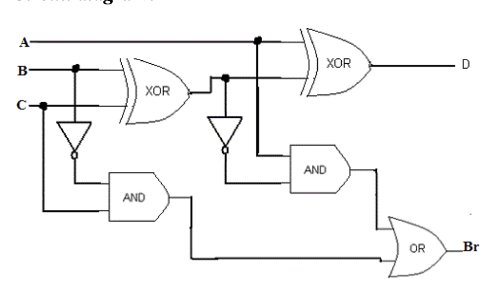
   
  <em>Figure 1: 1-Bit Binary Subtractor Block Diagram</em>

### Ripple Borrow Subtractor (RBS)
A **Ripple Borrow Subtractor (RBS)** cascades multiple 1-bit full subtractor cells to subtract multi-bit binary numbers. Similar to a Ripple Carry Adder (RCA) in addition, the borrow-out from each bit slice ripples as the borrow-in to the subsequent higher-order bit slice:
- **Advantages**: Straightforward modular architecture and minimal silicon layout area.
- **Disadvantages**: Suffers from cumulative propagation delay because high-order borrow outputs cannot evaluate until all lower-order borrow bits have settled sequentially.

  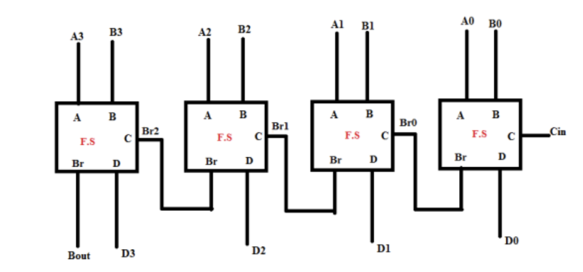
   
  <em>Figure 2: 8-Bit Ripple Borrow Subtractor (RBS) Architecture</em>

---

## 🔬 Design Approaches

### 1. Pseudo NMOS Logic
Pseudo NMOS logic replaces the entire PMOS pull-up network of static CMOS with a single grounded PMOS load transistor ($V_{GS} = -V_{DD}$, permanently active).
- **Area**: High density; requires only $N + 1$ transistors compared to $2N$ in complementary static CMOS.
- **Delay**: Substantially reduced input capacitance because inputs drive only NMOS gates, yielding extremely fast propagation speeds.
- **Power Trade-off**: High static power dissipation whenever the NMOS pull-down network is conductive, resulting in a continuous DC path from $V_{DD}$ to Ground.

### 2. Dynamic Logic
Dynamic logic operates in two alternating phases driven by a periodic clock signal ($\text{CLK}$):
1. **Precharge Phase ($\text{CLK} = 0$)**: The output node is precharged high to $V_{DD}$ through a pull-up PMOS transistor while the bottom foot NMOS transistor remains OFF.
2. **Evaluate Phase ($\text{CLK} = 1$)**: The PMOS turns OFF, the foot NMOS turns ON, and the output node conditionally discharges to Ground depending on the logic states of the NMOS pull-down tree.
- **Area**: Low transistor count ($N + 2$ transistors) with minimal gate input capacitance.
- **Power**: Eliminates static DC current dissipation because precharge and evaluate paths are never simultaneously ON.
- **Delay Trade-off**: Switching speed is constrained by the clock period and discharge latency through cascaded NMOS series trees.

---

## 💻 Cadence Implementation: Elementary Gates & 1-Bit Subtractor

Each logic gate and single-bit subtractor was designed and simulated at the transistor level in **Cadence Virtuoso**:

| Logic Block | Cadence Schematic | Simulated Transient Waveform |
| :--- | :---: | :---: |
| **NAND Gate** | 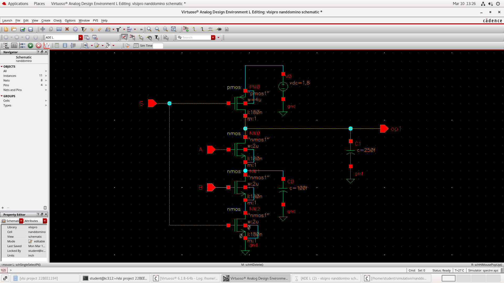 | 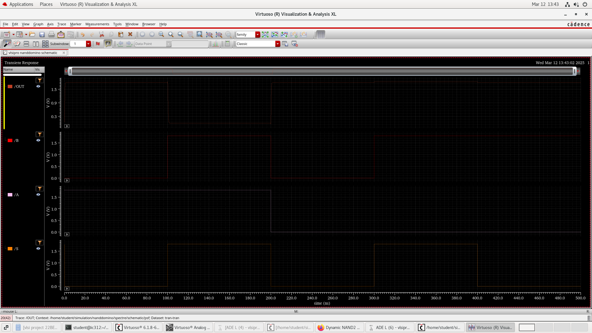 |
| **AND Gate** | 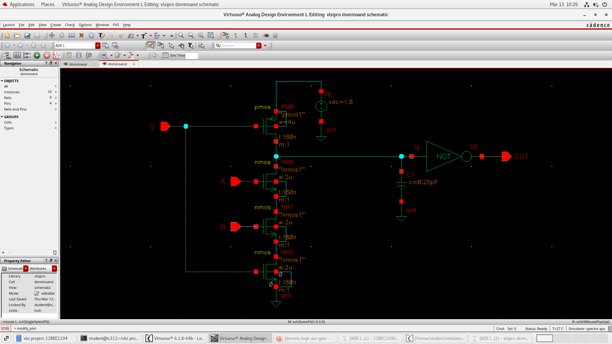 | 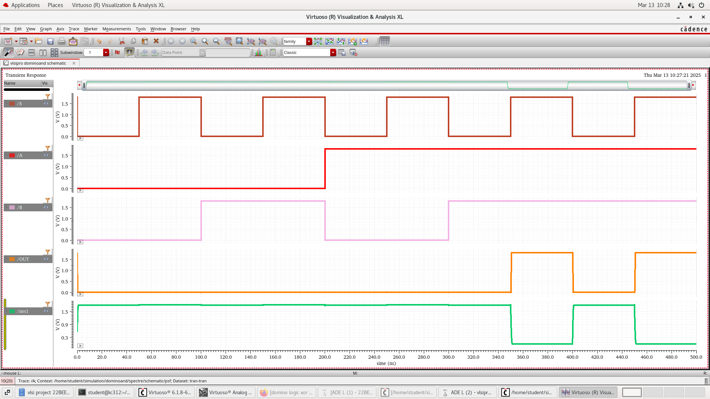 |
| **OR Gate** | 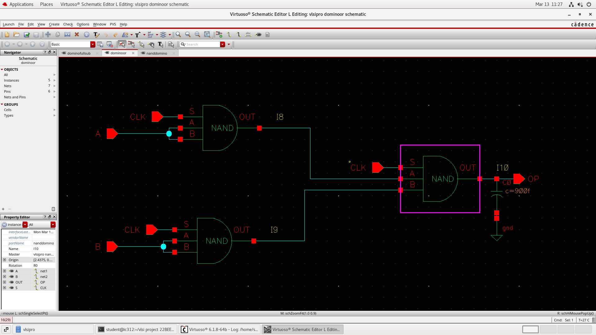 | 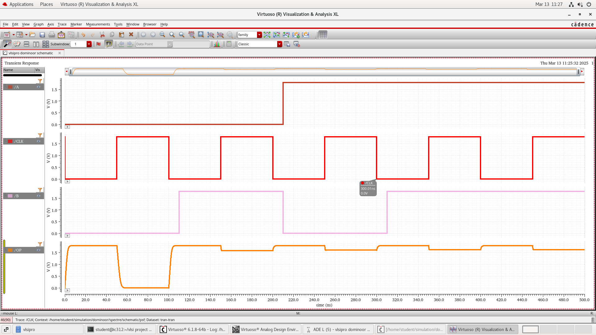 |
| **XOR Gate** | 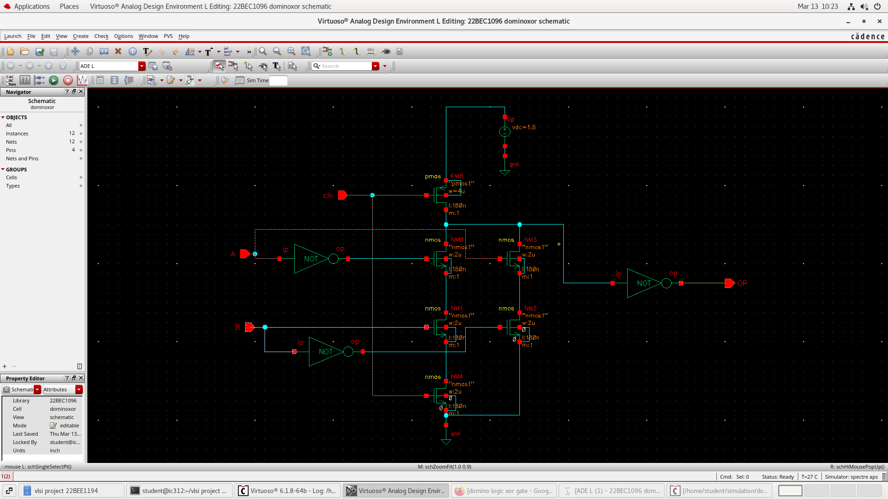 | 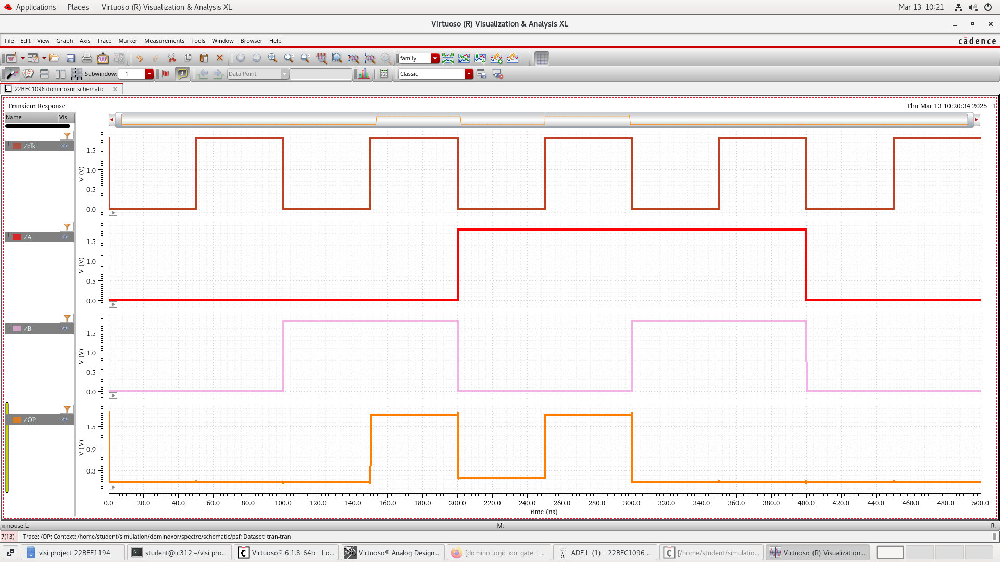 |
| **Full Subtractor** | 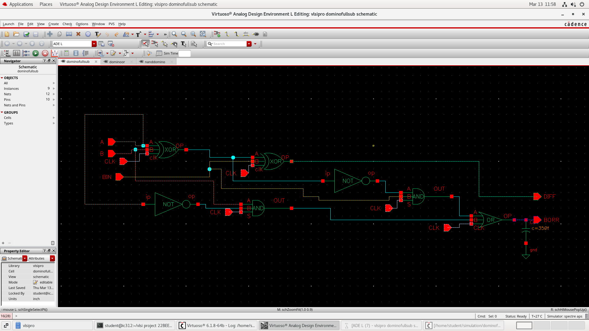 | 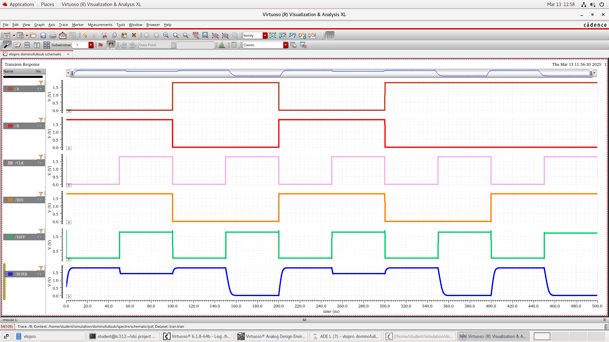 |

*Full Subtractor Supplementary Transient Output:*

  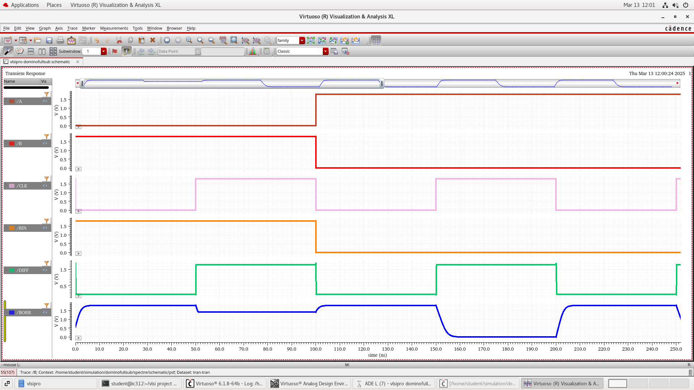
   
  <em>Figure 3: Full Subtractor Detailed Signal Transient Response</em>

---

## ⚡ 8-Bit Full Subtractor Implementations

### 1. Pseudo NMOS 8-Bit Subtractor
The 8-bit Pseudo NMOS subtractor integrates single pull-up PMOS transistors with an NMOS pull-down network across all cascaded stages.

| Type | Circuit / Output Visualization |
| :--- | :--- |
| **1-Bit Pseudo NMOS Output** | 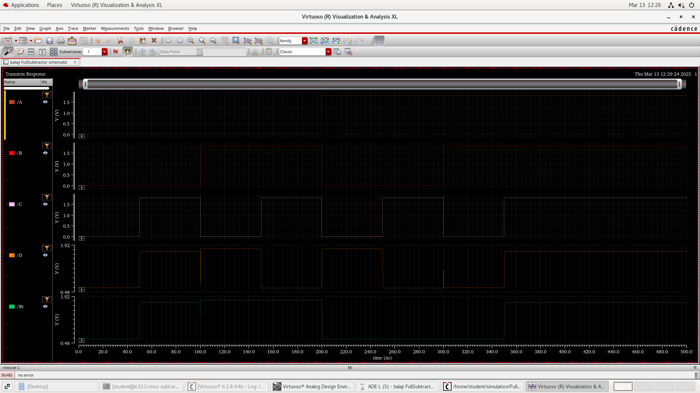 |
| **8-Bit Schematic Circuit** | 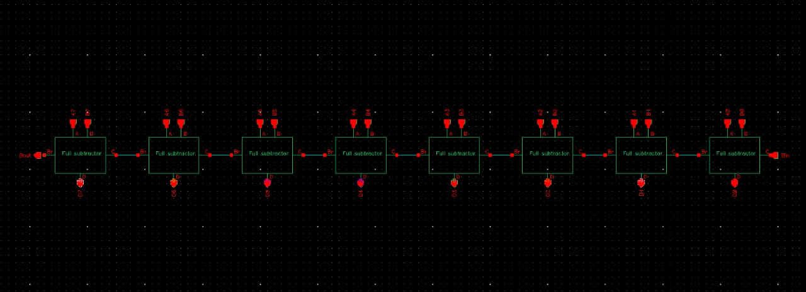 |
| **8-Bit Transient Output** | 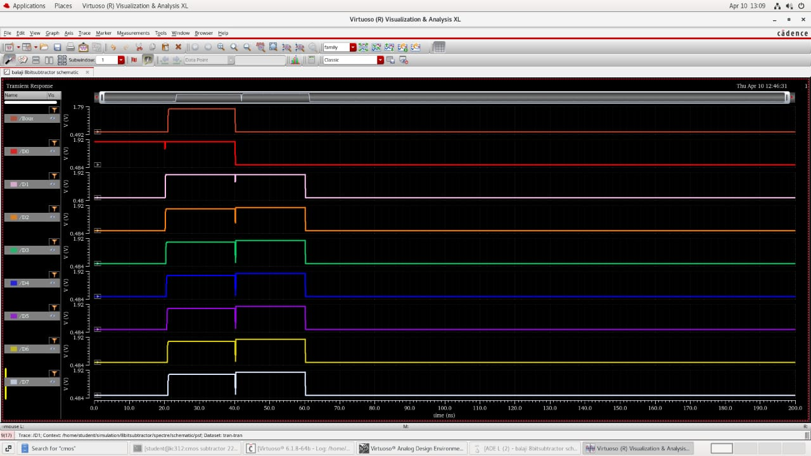 |

---

### 2. Dynamic Logic 8-Bit Subtractor
The 8-bit Dynamic Logic subtractor utilizes clocked precharge/evaluation stages to achieve low power dissipation.

| Type | Circuit / Output Visualization |
| :--- | :--- |
| **8-Bit Schematic Circuit** | 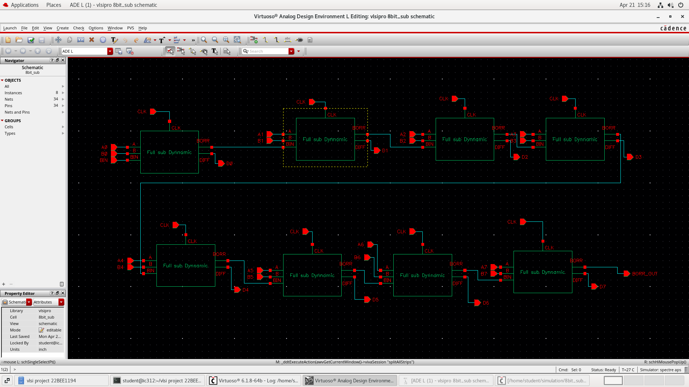 |
| **8-Bit Transient Output (Stage 1)** | 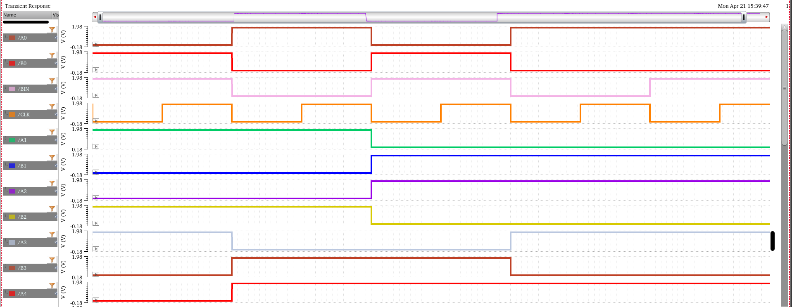 |
| **8-Bit Transient Output (Stage 2)** | 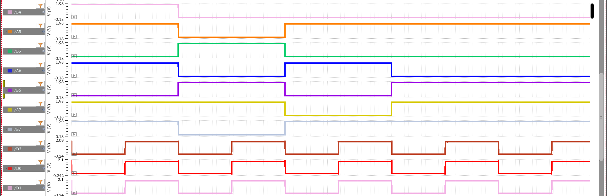 |
| **8-Bit Transient Output (Stage 3)** | 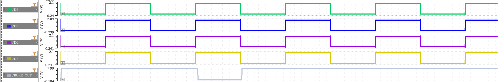 |

---

## 📊 Results: Power and Delay Analysis

All quantitative metrics were extracted directly from the Cadence Spectre simulation outputs across Slides 23 and 24 of the project presentation:

### Performance Comparison Matrix (8-Bit Subtractor)

| Performance Parameter | Dynamic Logic (8-Bit) | Pseudo NMOS (8-Bit) | Comparison & Trade-off Observation |
| :--- | :---: | :---: | :--- |
| **Average Power Dissipation** | **`4.118 mW`** (`4.118E-3 W`) | **`191.5 mW`** (`191.5E-3 W`) | **Dynamic Logic achieves 46.5× lower power** |
| **Delay: Bit 0 Input to Difference Output** | **`49.85 ns`** (`49.85E-9 s`) | **`261.4 ps`** (`261.4E-12 s`) | **Pseudo NMOS is 190.7× faster** |
| **Delay: Bit 0 Input to Borrow Output** | **`99.35 ns`** (`99.35E-9 s`) | **`1.028 ns`** (`1.028E-9 s`) | **Pseudo NMOS is 96.6× faster** |

---

### Cadence Calculation Screenshots

#### Dynamic Logic Measurements (Slide 23 & 24)

  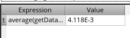
  &nbsp;&nbsp;&nbsp;&nbsp;
  
   
  <em>Left: Dynamic Logic Power (4.118 mW) | Right: Dynamic Logic Bit 0 to Difference Delay (49.85 ns)</em>

  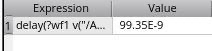
   
  <em>Dynamic Logic Bit 0 to Borrow Delay (99.35 ns)</em>

#### Pseudo NMOS Measurements (Slide 24)

  
  &nbsp;&nbsp;&nbsp;&nbsp;
  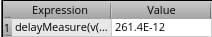
   
  <em>Left: Pseudo NMOS Power (191.5 mW) | Right: Pseudo NMOS Bit 0 to Difference Delay (261.4 ps)</em>

  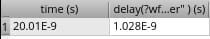
   
  <em>Pseudo NMOS Bit 0 to Borrow Delay (1.028 ns)</em>

---

## 🎯 Conclusion

The comparative simulation results clearly illustrate the fundamental **delay vs. area/power trade-off** in VLSI arithmetic circuit design:

1. **Pseudo NMOS Design**:
   - **Advantage**: Superior propagation speed, delivering an ultra-fast difference delay of **261.4 ps** and borrow delay of **1.028 ns** (up to ~190× faster than dynamic logic). Compact layout area with minimal PMOS count.
   - **Trade-off**: High static power dissipation (**191.5 mW**) due to direct DC conduction paths when the pull-down network is active. Best suited for high-speed datapath circuits where operating speed is prioritized over static power budget.

2. **Dynamic Logic Design**:
   - **Advantage**: Drastically reduced power dissipation of **4.118 mW** (~46.5× lower power than Pseudo NMOS) by eliminating static current paths via clocked precharge and evaluation phases.
   - **Trade-off**: Higher propagation delay (**49.85 ns** Difference, **99.35 ns** Borrow) stemming from clock synchronization and discharge latencies through cascaded NMOS series pull-down paths. Best suited for power-constrained VLSI applications.

---

## 📚 References

1. *Comparison of Low Power and High Speed Full Adder Using Alternative Logic Styles*, International Journal of Engineering Research and Applications (IJERA). [Available Online](https://www.ijera.com/papers/Vol3_issue5/LO3519791983.pdf)
2. *Design and Analysis of High Performance CMOS Adders and Subtractors*, SBMicro / SForum. [Available Online](https://sbmicro.org.br/sforum-eventos/sforum2001/godoi.pdf)

---

## 📄 License

This project is licensed under the MIT License - see the [LICENSE](LICENSE) file for details.
